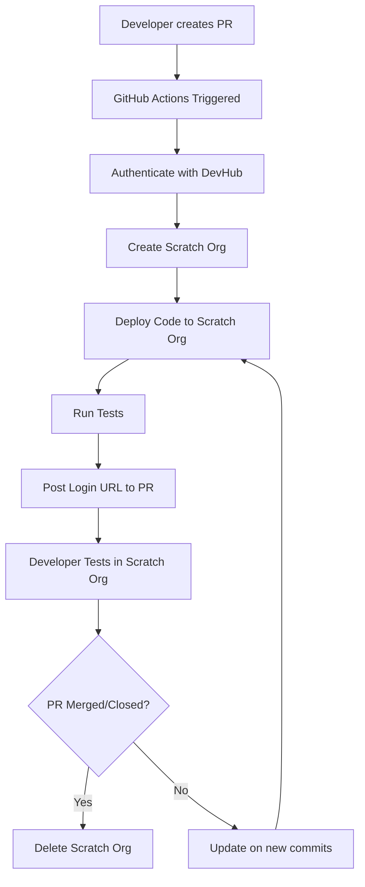

# Salesforce DX CI/CD Framework Implementation Plan

## Overview
This document outlines a comprehensive CI/CD framework for Salesforce DX projects using GitHub Actions, designed to work similarly to Vercel's deployment model. This framework will serve as a template for new customer projects with automated scratch org management, deployment, and testing capabilities.

## Architecture Overview



## Prerequisites

### 1. Salesforce Setup
- **DevHub Org**: Enable DevHub in your Salesforce org
- **Connected App**: Create a Connected App for JWT-based authentication
- **Integration User**: Create a dedicated integration user with appropriate permissions

### 2. GitHub Repository Setup
- **Template Repository**: Configure this repository as a GitHub template
- **Branch Protection**: Set up branch protection rules for main branch
- **Secrets Management**: Configure GitHub Secrets for authentication

## Implementation Steps

### Phase 1: Authentication Setup

#### 1.1 Create Connected App in Salesforce
```bash
# Navigate to Setup > App Manager > New Connected App
# Configure the following settings:
# - Name: "GitHub Actions CI/CD"
# - API Name: "GitHub_Actions_CI_CD"
# - Contact Email: your-email@company.com
# - Enable OAuth Settings: ✓
# - Callback URL: http://localhost:1717/OauthRedirect
# - Use digital signatures: ✓ (upload certificate)
# - Selected OAuth Scopes:
#   - Access and manage your data (api)
#   - Perform requests on your behalf at any time (refresh_token, offline_access)
#   - Access your basic information (id, profile, email, address, phone)
```

#### 1.2 Generate SSL Certificate and Private Key
```bash
# Generate private key
openssl genrsa -out server.key 2048

# Generate certificate signing request
openssl req -new -key server.key -out server.csr \
  -subj "/C=US/ST=CA/L=San Francisco/O=YourCompany/CN=github-actions"

# Generate self-signed certificate (valid for 1 year)
openssl x509 -req -days 365 -in server.csr -signkey server.key -out server.crt

# Convert private key to base64 for GitHub Secrets
base64 -w 0 server.key > server.key.base64
```

#### 1.3 Configure GitHub Secrets
Navigate to GitHub Repository Settings > Secrets and variables > Actions and add:

| Secret Name | Description | Value |
|-------------|-------------|-------|
| `DEVHUB_CONSUMER_KEY` | Connected App Consumer Key | From Connected App |
| `DEVHUB_PRIVATE_KEY` | Base64 encoded private key | Content of server.key.base64 |
| `DEVHUB_USERNAME` | DevHub integration user username | integration-user@yourcompany.com |
| `DEVHUB_INSTANCE_URL` | Salesforce instance URL | https://yourcompany.my.salesforce.com |

### Phase 2: GitHub Actions Workflow

#### 2.1 Create Workflow Directory Structure
```
.github/
├── workflows/
│   ├── pr-deployment.yml
│   ├── pr-cleanup.yml
│   └── main-deployment.yml
├── scripts/
│   ├── setup-sfdx.sh
│   ├── create-scratch-org.sh
│   ├── deploy-to-scratch-org.sh
│   └── cleanup-scratch-org.sh
└── templates/
    └── pr-comment.md
```

#### 2.2 Main PR Deployment Workflow (pr-deployment.yml)
```yaml
name: 🚀 PR Deployment

on:
  pull_request:
    types: [opened, synchronize, reopened]
    branches: [main]

concurrency:
  group: pr-${{ github.event.number }}
  cancel-in-progress: true

env:
  SCRATCH_ORG_ALIAS: "pr-${{ github.event.number }}-${{ github.run_number }}"
  DEVHUB_ALIAS: "devhub"

jobs:
  validate-and-deploy:
    name: 🔄 Validate & Deploy to Scratch Org
    runs-on: ubuntu-latest
    timeout-minutes: 30
    
    outputs:
      scratch-org-url: ${{ steps.get-org-url.outputs.url }}
      scratch-org-username: ${{ steps.get-org-info.outputs.username }}
      
    steps:
      - name: 📥 Checkout Repository
        uses: actions/checkout@v4
        with:
          fetch-depth: 0

      - name: 🔧 Setup Node.js
        uses: actions/setup-node@v4
        with:
          node-version: '18'
          cache: 'npm'

      - name: 📦 Install Dependencies
        run: npm ci

      - name: 🎯 Install Salesforce CLI
        run: |
          npm install @salesforce/cli --global
          sf version

      - name: 🔐 Authenticate with DevHub
        run: |
          echo "${{ secrets.DEVHUB_PRIVATE_KEY }}" | base64 --decode > server.key
          sf org login jwt \
            --username "${{ secrets.DEVHUB_USERNAME }}" \
            --jwt-key-file server.key \
            --client-id "${{ secrets.DEVHUB_CONSUMER_KEY }}" \
            --instance-url "${{ secrets.DEVHUB_INSTANCE_URL }}" \
            --alias ${{ env.DEVHUB_ALIAS }} \
            --set-default-dev-hub
          rm server.key

      - name: 🏗️ Create Scratch Org
        id: create-scratch-org
        run: |
          sf org create scratch \
            --definition-file config/project-scratch-def.json \
            --alias ${{ env.SCRATCH_ORG_ALIAS }} \
            --duration-days 7 \
            --set-default \
            --wait 10
          
          echo "✅ Scratch org created successfully"

      - name: 📋 Get Scratch Org Info
        id: get-org-info
        run: |
          ORG_INFO=$(sf org display --target-org ${{ env.SCRATCH_ORG_ALIAS }} --json)
          USERNAME=$(echo $ORG_INFO | jq -r '.result.username')
          INSTANCE_URL=$(echo $ORG_INFO | jq -r '.result.instanceUrl')
          
          echo "username=$USERNAME" >> $GITHUB_OUTPUT
          echo "instance-url=$INSTANCE_URL" >> $GITHUB_OUTPUT
          echo "📋 Scratch Org Username: $USERNAME"
          echo "🌐 Instance URL: $INSTANCE_URL"

      - name: 🔗 Generate Login URL
        id: get-org-url
        run: |
          LOGIN_URL=$(sf org open --url-only --target-org ${{ env.SCRATCH_ORG_ALIAS }})
          echo "url=$LOGIN_URL" >> $GITHUB_OUTPUT
          echo "🔗 Login URL: $LOGIN_URL"

      - name: 🚀 Deploy Source to Scratch Org
        run: |
          sf project deploy start \
            --target-org ${{ env.SCRATCH_ORG_ALIAS }} \
            --wait 10 \
            --verbose
          
          echo "✅ Deployment completed successfully"

      - name: 🧪 Run Apex Tests
        id: run-tests
        run: |
          sf apex run test \
            --target-org ${{ env.SCRATCH_ORG_ALIAS }} \
            --wait 10 \
            --result-format human \
            --output-dir ./test-results \
            --code-coverage
          
          echo "✅ Tests completed successfully"

      - name: 📊 Upload Test Results
        uses: actions/upload-artifact@v4
        if: always()
        with:
          name: test-results-pr-${{ github.event.number }}
          path: ./test-results/
          retention-days: 30

      - name: 💬 Comment on PR with Scratch Org Details
        uses: actions/github-script@v7
        with:
          github-token: ${{ secrets.GITHUB_TOKEN }}
          script: |
            const loginUrl = '${{ steps.get-org-url.outputs.url }}';
            const username = '${{ steps.get-org-info.outputs.username }}';
            const scratchOrgAlias = '${{ env.SCRATCH_ORG_ALIAS }}';
            const runId = '${{ github.run_id }}';
            const runUrl = `https://github.com/${{ github.repository }}/actions/runs/${runId}`;
            
            const body = `## 🚀 Scratch Org Deployed Successfully
            
            Your changes have been deployed to a temporary Scratch Org for testing:
            
            ### 🔗 Quick Access
            - **[🌐 Open Scratch Org](${loginUrl})** *(Click to login directly)*
            - **Username:** \`${username}\`
            - **Org Alias:** \`${scratchOrgAlias}\`
            
            ### 📊 Deployment Details
            - **GitHub Action:** [View Run](${runUrl})
            - **Duration:** 7 days (auto-expires)
            - **Branch:** \`${{ github.head_ref }}\`
            - **Commit:** \`${{ github.sha }}\`
            
            ### ⚡ Next Steps
            1. Click the link above to access your Scratch Org
            2. Test your changes thoroughly
            3. Push additional commits to update this deployment
            4. This org will be automatically deleted when the PR is closed
            
            ---
            *This comment will be updated with each new commit to this PR.*`;
            
            // Check if there's already a comment from this bot
            const comments = await github.rest.issues.listComments({
              owner: context.repo.owner,
              repo: context.repo.repo,
              issue_number: context.issue.number
            });
            
            const botComment = comments.data.find(comment => 
              comment.user.type === 'Bot' && 
              comment.body.includes('🚀 Scratch Org Deployed Successfully')
            );
            
            if (botComment) {
              // Update existing comment
              await github.rest.issues.updateComment({
                owner: context.repo.owner,
                repo: context.repo.repo,
                comment_id: botComment.id,
                body: body
              });
            } else {
              // Create new comment
              await github.rest.issues.createComment({
                owner: context.repo.owner,
                repo: context.repo.repo,
                issue_number: context.issue.number,
                body: body
              });
            }

  security-scan:
    name: 🔒 Security & Quality Scan
    runs-on: ubuntu-latest
    needs: validate-and-deploy
    
    steps:
      - name: 📥 Checkout Repository
        uses: actions/checkout@v4

      - name: 🔍 Run Salesforce Code Analyzer
        run: |
          npm install @salesforce/sfdx-scanner --global
          sfdx scanner:run --target "force-app/**/*.cls" --format json --outfile security-results.json
          
      - name: 📊 Upload Security Results
        uses: actions/upload-artifact@v4
        with:
          name: security-scan-pr-${{ github.event.number }}
          path: security-results.json
          retention-days: 30
```

#### 2.3 PR Cleanup Workflow (pr-cleanup.yml)
```yaml
name: 🧹 PR Cleanup

on:
  pull_request:
    types: [closed]
    branches: [main]

env:
  SCRATCH_ORG_ALIAS: "pr-${{ github.event.number }}-*"
  DEVHUB_ALIAS: "devhub"

jobs:
  cleanup:
    name: 🗑️ Delete Scratch Org
    runs-on: ubuntu-latest
    timeout-minutes: 10
    
    steps:
      - name: 🎯 Install Salesforce CLI
        run: |
          npm install @salesforce/cli --global
          sf version

      - name: 🔐 Authenticate with DevHub
        run: |
          echo "${{ secrets.DEVHUB_PRIVATE_KEY }}" | base64 --decode > server.key
          sf org login jwt \
            --username "${{ secrets.DEVHUB_USERNAME }}" \
            --jwt-key-file server.key \
            --client-id "${{ secrets.DEVHUB_CONSUMER_KEY }}" \
            --instance-url "${{ secrets.DEVHUB_INSTANCE_URL }}" \
            --alias ${{ env.DEVHUB_ALIAS }} \
            --set-default-dev-hub
          rm server.key

      - name: 🗑️ Delete Scratch Orgs
        run: |
          # List all scratch orgs for this PR
          sf org list --json | jq -r '.result.scratchOrgs[] | select(.alias | test("^pr-${{ github.event.number }}-")) | .alias' | while read alias; do
            if [ ! -z "$alias" ]; then
              echo "🗑️ Deleting scratch org: $alias"
              sf org delete scratch --target-org "$alias" --no-prompt || true
            fi
          done
          
          echo "✅ Cleanup completed"

      - name: 💬 Update PR Comment
        uses: actions/github-script@v7
        with:
          github-token: ${{ secrets.GITHUB_TOKEN }}
          script: |
            const comments = await github.rest.issues.listComments({
              owner: context.repo.owner,
              repo: context.repo.repo,
              issue_number: context.issue.number
            });
            
            const botComment = comments.data.find(comment => 
              comment.user.type === 'Bot' && 
              comment.body.includes('🚀 Scratch Org Deployed Successfully')
            );
            
            if (botComment) {
              const updatedBody = botComment.body + '\n\n---\n**🗑️ Scratch Org Deleted:** This PR has been closed and the associated scratch org has been automatically deleted.';
              
              await github.rest.issues.updateComment({
                owner: context.repo.owner,
                repo: context.repo.repo,
                comment_id: botComment.id,
                body: updatedBody
              });
            }
```

### Phase 3: Project Template Setup

#### 3.1 Enhanced Project Structure
```
salesforce-dx-template/
├── .github/
│   ├── workflows/
│   ├── scripts/
│   └── templates/
├── config/
│   ├── project-scratch-def.json
│   ├── dev-scratch-def.json
│   └── qa-scratch-def.json
├── force-app/
│   └── main/default/
├── scripts/
│   ├── setup/
│   ├── data/
│   └── deploy/
├── docs/
│   ├── SETUP.md
│   ├── DEPLOYMENT.md
│   └── TROUBLESHOOTING.md
├── sfdx-project.json
├── package.json
├── .forceignore
├── .gitignore
└── README.md
```

#### 3.2 Enhanced Scratch Org Definition
```json
{
  "orgName": "PR Scratch Org",
  "edition": "Developer",
  "features": [
    "EnableSetPasswordInApi",
    "MultiCurrency",
    "PersonAccounts",
    "Communities",
    "ServiceCloud",
    "MarketingCloud",
    "EinsteinAnalytics"
  ],
  "settings": {
    "lightningExperienceSettings": {
      "enableS1DesktopEnabled": true
    },
    "mobileSettings": {
      "enableS1EncryptedStoragePref2": false
    },
    "securitySettings": {
      "enableAdminLoginAsAnyUser": true,
      "sessionSettings": {
        "forceRelogin": false,
        "sessionTimeout": "TwentyFourHours"
      }
    },
    "chatterSettings": {
      "enableChatter": true
    }
  }
}
```

### Phase 4: Template Repository Configuration

#### 4.1 Repository Template Settings
```yaml
# .github/template-config.yml
name: "Salesforce DX Project Template"
description: "A comprehensive Salesforce DX project template with CI/CD"
topics:
  - salesforce
  - salesforce-dx
  - github-actions
  - ci-cd
  - scratch-orgs
template: true
```

#### 4.2 Repository Creation Script
```bash
#!/bin/bash
# scripts/create-new-project.sh

PROJECT_NAME=$1
CUSTOMER_NAME=$2
GITHUB_ORG=$3

if [ -z "$PROJECT_NAME" ] || [ -z "$CUSTOMER_NAME" ] || [ -z "$GITHUB_ORG" ]; then
    echo "Usage: $0 <project-name> <customer-name> <github-org>"
    exit 1
fi

# Create new repository from template
gh repo create "$GITHUB_ORG/$PROJECT_NAME" \
    --template "$GITHUB_ORG/salesforce-dx-template" \
    --description "Salesforce DX project for $CUSTOMER_NAME" \
    --private

# Clone the new repository
git clone "https://github.com/$GITHUB_ORG/$PROJECT_NAME.git"
cd "$PROJECT_NAME"

# Update project configuration
sed -i "s/cursor-rules-sfdx/$PROJECT_NAME/g" sfdx-project.json
sed -i "s/Salesforce DX Template/$CUSTOMER_NAME Salesforce Project/g" config/project-scratch-def.json

# Commit changes
git add .
git commit -m "Initialize project for $CUSTOMER_NAME"
git push origin main

echo "✅ Project $PROJECT_NAME created successfully!"
echo "🔗 Repository: https://github.com/$GITHUB_ORG/$PROJECT_NAME"
```

## Security Implementation

### Authentication Tokens Required

| Token/Secret | Purpose | Where to Store | How to Generate |
|--------------|---------|----------------|-----------------|
| `DEVHUB_CONSUMER_KEY` | Connected App Client ID | GitHub Secrets | From Connected App |
| `DEVHUB_PRIVATE_KEY` | JWT Signing Key | GitHub Secrets | OpenSSL generation |
| `DEVHUB_USERNAME` | Integration User | GitHub Secrets | Salesforce user |
| `DEVHUB_INSTANCE_URL` | Org URL | GitHub Secrets | Your org URL |
| `GITHUB_TOKEN` | PR Comments/API | Auto-provided | GitHub automatic |

### Security Best Practices

1. **Dedicated Integration User**
   - Create a specific user for CI/CD operations
   - Assign minimal required permissions
   - Use a strong, unique password
   - Enable MFA where possible

2. **Connected App Security**
   - Use digital certificates for JWT
   - Implement IP restrictions if possible
   - Regular rotation of certificates
   - Monitor usage logs

3. **GitHub Secrets Management**
   - Use environment-specific secrets
   - Regular rotation of keys
   - Audit access logs
   - Implement least-privilege access

4. **Scratch Org Security**
   - Automatic expiration (7 days max)
   - No production data
   - Isolated environments
   - Automatic cleanup

## Monitoring and Maintenance

### 1. Automated Monitoring
```yaml
# .github/workflows/monitor-resources.yml
name: 🔍 Resource Monitoring

on:
  schedule:
    - cron: '0 0 * * *'  # Daily at midnight
  workflow_dispatch:

jobs:
  monitor:
    runs-on: ubuntu-latest
    steps:
      - name: Check Scratch Org Limits
        run: |
          # Check daily/monthly limits
          # Alert if approaching limits
          # Clean up old orgs if needed
```

### 2. Health Checks
- Daily scratch org limit monitoring
- Weekly certificate expiration checks
- Monthly security audit
- Quarterly dependency updates

## Troubleshooting Guide

### Common Issues and Solutions

| Issue | Symptoms | Solution |
|-------|----------|----------|
| Authentication Failure | JWT login fails | Verify certificate and user permissions |
| Scratch Org Creation Fails | Org creation timeout | Check DevHub limits and definition file |
| Deployment Failure | Source push fails | Validate metadata and dependencies |
| Test Failures | Tests don't run | Check test classes and data setup |

### Debug Commands
```bash
# Enable debug logging
sf config set org-max-query-limit=50000 --global
sf config set org-api-version=62.0 --global

# Check authentication
sf org list --all

# Validate project
sf project deploy validate --source-dir force-app

# Check limits
sf limits api display
```

## Cost Considerations

### Scratch Org Allocations
- **Developer Edition DevHub**: 6 daily scratch orgs
- **Enterprise Edition DevHub**: 80 daily scratch orgs
- **Unlimited Edition DevHub**: 100 daily scratch orgs

### Optimization Strategies
1. **Smart Cleanup**: Delete orgs immediately when PRs are closed
2. **Reuse Strategy**: Consider reusing orgs for draft PRs
3. **Limit Duration**: Use minimum required duration (1-7 days)
4. **Concurrent Limits**: Implement concurrency controls

## Future Enhancements

### Phase 2 Features
1. **Multi-Environment Support**
   - Integration environments
   - UAT environments
   - Production deployments

2. **Advanced Testing**
   - UI testing with Playwright
   - Performance testing
   - Security scanning integration

3. **Deployment Strategies**
   - Blue-green deployments
   - Canary releases
   - Rollback mechanisms

### Phase 3 Features
1. **Advanced Monitoring**
   - Performance metrics
   - Usage analytics
   - Cost optimization

2. **Integration Ecosystem**
   - Slack notifications
   - Jira integration
   - ServiceNow integration

## Conclusion

This CI/CD framework provides a robust, scalable solution for Salesforce DX development that mirrors Vercel's deployment experience. It ensures:

- **Automated Environment Management**: Scratch orgs are created, managed, and cleaned up automatically
- **Secure Authentication**: JWT-based authentication with proper secret management
- **Developer Experience**: One-click access to test environments via PR comments
- **Resource Optimization**: Automatic cleanup and monitoring to manage costs
- **Template Reusability**: Easy replication for new customer projects

The framework is designed to be production-ready while maintaining simplicity and security best practices.